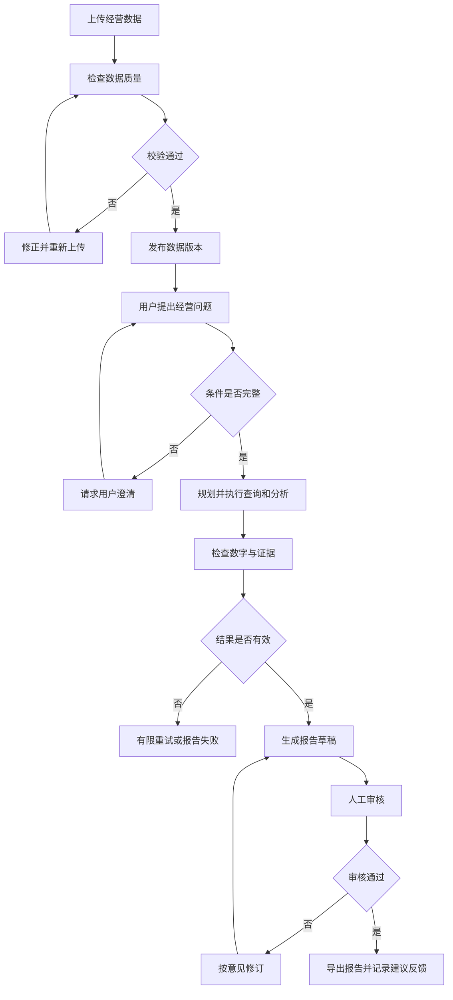
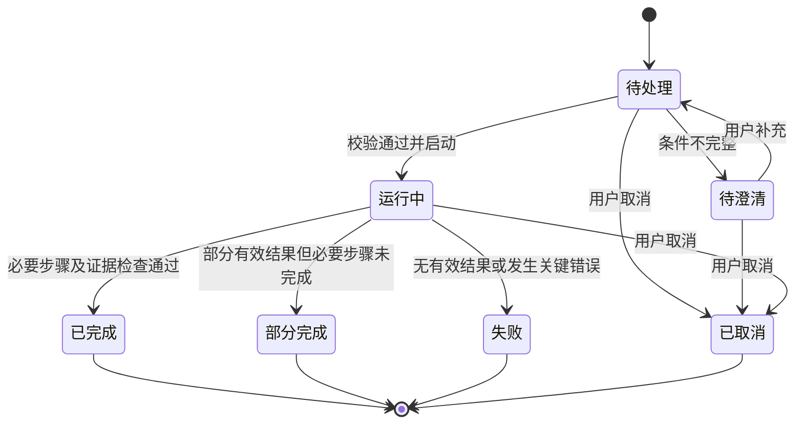

# RetailPilot 产品需求文档

| 项目 | 内容 |
| --- | --- |
| 产品名称 | RetailPilot（零售智航） |
| 正式系统名称 | 基于多智能体协作的零售企业经营数据智能分析与决策支持系统 |
| 文档版本 | v0.1 |
| 编写日期 | 2026-09-19 |
| 文档状态 | 初版，待项目组评审 |
| 适用阶段 | 课程选题、需求分析、后续设计与开发规划 |
| 成员与负责人 | 待填写，按实际 1–3 人配置 |

本项目拟建设一个面向中小型零售企业的经营分析应用。用户导入经营数据后，可以查看统一口径的销售指标、用自然语言发起分析，并依据可追溯的数据证据形成经营报告。多智能体负责协作执行分析任务，管理人员负责判断建议是否适用及是否采纳。

当前实现状态与验证范围见 [需求追踪与最新验收](batch2-3-acceptance-2026-10-02.md)。本文件保留需求目标；实际安装从空库创建管理员，不预置公开账号。

本 PRD 定义产品目标、业务边界、需求与验收条件。课程要求的来源见 [课程要求对照](course-requirements.md)。文中的功能、规模和性能数值属于本项目拟定目标，尚未通过实现验证；课程明确要求与项目自行制定的要求分别记录。

## 1. 背景与问题

### 1.1 目标业务场景

以一家经营多个门店、多个商品品类的零售企业为原型，分析销售订单及订单明细，覆盖日期、地区、门店、商品和品类维度。经营管理人员需要回答“卖得怎么样”“哪里发生变化”“哪些因素贡献了变化”“下一步需要核实或调整什么”。

第一版采用单企业场景，以脱敏数据或明确标识的模拟数据进行课程演示。企业原有交易系统提供订单记录，RetailPilot 接收数据并开展分析，不承担交易录入和收银职责。

### 1.2 待验证的用户问题

以下是产品假设，后续通过教师反馈、同学扮演业务角色的场景走查，以及可获得的零售从业者访谈验证；当前不宣称已经完成真实企业调研。

| 问题 | 典型表现 | 产品响应 |
| --- | --- | --- |
| 数据准备重复 | 每次分析都要整理表格和处理错误记录 | 统一导入、质量校验、发布数据版本 |
| 查询依赖技术人员 | 管理者知道问题，但不会写查询语句 | 自然语言提问、条件澄清、结构化分析任务 |
| 看板难解释变化 | 看到销售下降，却不知道先检查哪个门店或品类 | 分维度拆解变化，展示贡献和证据 |
| 分析结果难复核 | 报告只有文字结论，没有指标和筛选范围 | 绑定数据版本、查询证据、计算口径及图表 |
| 建议缺少跟进 | 生成建议后不知道是否被采纳 | 人工审核、记录采纳状态与反馈 |

## 2. 产品目标和成功标准

### 2.1 产品目标

1. 让用户基于统一的数据与指标定义完成销售分析，减少同一问题出现不同统计口径。
2. 支持“问题澄清、任务规划、数据查询、统计分析、结果检查、报告生成”的协作过程。
3. 让关键数字和结论能够回溯到数据范围与计算结果，区分事实、解释假设和建议。
4. 支撑课程需要的用例、对象、动态交互及系统设计，具备可独立划分的业务子系统。

### 2.2 第一版完成标准

| 目标 | 验收要求 |
| --- | --- |
| 业务完整性 | 能完整演示导入、发布、分析、审核、导出和反馈流程 |
| 数值正确性 | 固定验收数据上的确定性指标与人工核对值一致，金额展示误差不超过 0.01 元 |
| 智能问数能力 | 预先冻结的 30 道范围内问题中，至少 27 道得到正确数值及正确筛选条件；拒答不计成功 |
| 不确定性处理 | 缺少时间、指标含义歧义或必要字段时，给出澄清或缺失提示，不补造数据 |
| 可追溯性 | 每份成功报告的核心数值、变化描述均能定位证据，报告记录数据版本与指标版本 |
| 权限控制 | 所有跨门店越权用例均被阻止，下载和导出同样适用 |
| 多智能体协作 | 复杂分析任务记录各角色的结构化输入、输出和结果检查，不只展示角色名称 |

评估集至少包含 10 道基础聚合、8 道趋势比较、6 道维度拆解、6 道异常及报告问题；另设独立的歧义、空数据、越权与服务失败用例。评估时记录模型配置、提示词版本、数据版本和执行时间，人工评判报告是否把推测写成已证实原因。

## 3. 产品范围

### 3.1 范围和优先级

P0 是第一版演示必须完成的需求；P1 在 P0 验收后考虑；P2 暂不纳入本轮开发承诺。课程报告仍可分析扩展能力，但必须明确其阶段。

| 范围 | 内容 | 优先级 |
| --- | --- | --- |
| 账号与权限 | 预置账号登录、角色配置、门店可见范围 | P0 |
| 经营数据管理 | 标准 CSV 导入、字段映射、质量校验、版本发布、导入历史 | P0 |
| 指标看板 | 净销售额、有效订单数、客单价、销量及趋势和排名 | P0 |
| 智能分析 | 条件澄清、分析计划、受限数据查询、维度拆解、异常提示 | P0 |
| 决策报告 | 证据与图表、建议、人工审核、Markdown 导出、采纳反馈 | P0 |
| 过程追踪 | 任务状态、阶段结果、错误提示、取消、重试、审计 | P0 |
| 增强数据接入 | Excel 导入、预配置数据库连接、定时更新 | P1 |
| 扩展分析 | 有成本数据时的毛利分析，有库存数据时的库存风险分析 | P1 |
| 报告增强 | PDF 导出、周期性报告、多个报告版本比较 | P1 |
| 高级能力 | 销量预测、促销效果评估、客户分群、多企业隔离 | P2 |

### 3.2 第一版边界

第一版不承担采购、仓储出入库、财务记账、支付、订单履约等业务操作；不直接修改外部交易数据库，不自动执行调价或补货。管理人员可记录采纳建议，真实业务动作由企业已有流程执行。

默认采用人民币、单一时区 `Asia/Shanghai` 和日粒度分析。第一版要求数据提供“以订单成交日归属、截至快照时点已知退款后的交易快照”，不混用退款发生日口径。实时同步、多币种和跨企业数据隔离属于后续范围。

## 4. 用户与权限

产品角色与课程小组成员是不同概念。一个学生可负责多个产品角色涉及的业务需求。

| 角色 | 业务职责 | 可操作范围 |
| --- | --- | --- |
| 系统管理员 | 维护账号、角色、门店授权及系统配置 | 账号与配置；不因管理员身份自动获得经营数据读取权限 |
| 数据分析人员 | 导入与发布数据、检查质量、发起分析、编制报告 | 被授权门店的数据及相应任务、报告 |
| 经营管理人员 | 查看经营指标、发起分析、审核报告、记录采纳反馈 | 被授权门店的经营数据、报告及审核操作 |
| 门店业务人员 | 查看本门店指标和已审核报告、发起本门店分析 | 自己获授权的门店，不能访问其他门店 |

账号可以兼具多个角色。角色规定操作权限，门店授权规定数据范围，两者必须同时满足。任务的有效数据范围为用户授权与问题筛选范围的交集，必须在服务端实施；若问题明确请求无权访问的门店，提示无权限，不默默改成局部结果。

报告受众的授权范围必须覆盖报告全部数据范围，否则拒绝访问。权限变更后重新检查历史任务、报告及下载权限。共享页面不暴露无权限的门店名称、结果缓存和错误细节。

## 5. 业务子系统与课程分工

### 5.1 三个业务子系统

| 子系统 | 完整业务职责 | 主要对象 | 交付给其他子系统 |
| --- | --- | --- | --- |
| A 经营数据管理子系统 | 导入数据、处理质量问题、管理指标口径、发布可分析版本 | 数据集、导入批次、质量问题、数据版本、指标定义 | 可用数据版本、字段说明、指标定义、质量摘要 |
| B 智能经营分析子系统 | 接收问题、澄清条件、规划执行、生成指标与异常分析结果 | 分析任务、分析计划、执行步骤、查询证据、分析结果 | 结构化结果、图表数据、证据索引、限制说明 |
| C 决策报告管理子系统 | 编制报告、核查证据、审核、导出、记录建议反馈 | 报告、报告版本、审核记录、建议、反馈 | 可阅读报告、审核结论及建议处理状态 |

登录、权限与审计属于共享能力，由项目组统一设计，各子系统负责其业务入口中的授权和审计需求。每个成员都应分析所负责业务的界面、规则、数据、异常及交互关系。

### 5.2 不同人数的安排

| 组员人数 | 建议安排 |
| --- | --- |
| 1 人 | 负责完整系统；保留三个逻辑子系统以便建模，严格聚焦 P0 |
| 2 人 | 成员 A 负责经营数据管理与指标服务；成员 B 负责智能分析与决策报告，后者按一个完整业务子系统报题，需评估工作量并与教师确认 |
| 3 人 | 分别负责 A、B、C；每人独立完成对应分析与设计报告 |

三人报题名称示例：

- 基于多智能体协作的零售企业经营数据智能分析与决策支持系统-经营数据管理子系统
- 基于多智能体协作的零售企业经营数据智能分析与决策支持系统-智能经营分析子系统
- 基于多智能体协作的零售企业经营数据智能分析与决策支持系统-决策报告管理子系统

共享模型的变更需记录日期、提出人、影响需求及讨论结论。不得仅按前端、后端、数据库划分个人课程工作。

## 6. 核心业务流程

### 6.1 数据准备

数据分析人员选择数据集，下载模板并上传文件。系统检查文件格式、必填字段、主键、金额、时间和关联关系，将问题定位到文件及行号。用户修正后重新校验，通过后发布新版本。发布以完整快照为单位，失败批次不改变已发布版本；历史分析继续引用原版本。

### 6.2 自然语言经营分析

用户提出“2026 年 8 月华东地区净销售额为什么比 7 月下降”。系统先确定时间、地区、指标和数据版本，展示分析计划。分析过程计算总体变化，再按门店、品类等维度拆解，形成图表与证据。系统检查数字一致性和证据覆盖后生成可阅读结果。数据仅支持“变化主要集中在哪里”时，结果将业务原因列为待核实假设。

### 6.3 报告审核与反馈

数据分析人员从成功任务生成报告草稿，核对数字、证据与建议后提交审核。经营管理人员通过或退回并填写意见。通过后可导出正式报告，管理人员记录建议是否采纳、执行负责人和反馈。审核后的正文保持不可修改，后续修订产生新报告版本。

### 6.4 业务活动示意

此图用于说明产品流程，正式课程 UML 活动图在动态建模阶段补齐。

## 7. 功能需求

### 7.1 经营数据管理

| 编号 | 优先级 | 需求与规则 | 验收要点 |
| --- | --- | --- | --- |
| FR-01 | P0 | 支持登录、退出、角色和门店授权；无权限操作由服务端拒绝 | 不同账号访问同一任务或报告时按数据范围控制，登出后会话失效 |
| FR-02 | P0 | 按固定模板导入门店、商品、订单、订单明细 CSV；支持预览和字段映射 | 合法文件可导入；缺字段、格式不符时返回具体错误；不运行文件内容 |
| FR-03 | P0 | 校验必填、类型、主键、外键、非负金额和数量、退款约束、订单与明细合计 | 展示错误行号与原因；存在阻断错误时不能发布；允许下载错误清单 |
| FR-04 | P0 | 发布不可变数据版本，记录来源、快照时间、操作者、行数和质量摘要 | 发布后数据不原位修改；重传同一文件提示重复；新版本不改变旧报告 |
| FR-05 | P0 | 管理核心指标说明、公式、适用字段和版本 | 看板、问数、报告采用同一指标定义；指标变更生成新版本 |

阻断错误包括重复主键、无效关联、缺失金额或时间、退款超过成交金额、退货数量超过成交数量、总额不一致。警告包括可选客户标识缺失、有效成交明细净额为零等。发布需要显式确认警告；不得静默丢弃错误行后仍声称完整导入。

### 7.2 智能经营分析

| 编号 | 优先级 | 需求与规则 | 验收要点 |
| --- | --- | --- | --- |
| FR-06 | P0 | 展示核心指标、按日趋势、门店和品类排名，支持日期和门店筛选 | 看板合计与明细查询一致；无数据与数值零分开显示 |
| FR-07 | P0 | 接收自然语言问题，澄清缺少的时间、指标或比较范围 | “最近卖得如何”不能在未说明时间范围时直接给出确定结论 |
| FR-08 | P0 | 展示分析计划、任务进度及分阶段结果，支持取消和失败后创建重试任务 | 各阶段状态与实际执行一致；取消后不继续创建新的工具调用 |
| FR-09 | P0 | 按授权范围查询已发布数据，保存可复查的查询条件和结果摘要 | 禁止写入、删除及访问未授权表；保存查询指纹、数据版本和证据标识 |
| FR-10 | P0 | 计算趋势、排名、环比及门店和品类变化贡献 | 验收数据中的已知变化能复现；基期为零时不计算无穷增长率 |
| FR-11 | P0 | 按明确规则标记销售变化异常，列出候选解释及缺失证据 | 标注规则、阈值、比较周期；不能仅凭销量下降断定缺货或竞品影响 |
| FR-12 | P0 | 输出结论、图表及证据，支持查看筛选范围、单位和限制 | 文本、图表、表格数字一致；每个核心数字有证据引用 |

### 7.3 决策报告管理

| 编号 | 优先级 | 需求与规则 | 验收要点 |
| --- | --- | --- | --- |
| FR-13 | P0 | 从成功分析生成报告草稿，含问题、范围、指标、图表、发现、建议及限制 | 核心证据缺失时阻止提交审核；部分完成的任务仅可保存诊断草稿 |
| FR-14 | P0 | 支持草稿编辑、提交审核、通过、退回及新版本修订 | 记录审核人、时间、意见和版本；通过后的正文不能直接覆盖 |
| FR-15 | P0 | 支持报告检索、详情和 Markdown 导出 | 草稿导出有草稿标记；正式导出须已审核；图表附数据表，证据附范围与摘要，不依赖内部链接才能理解 |
| FR-16 | P0 | 建议支持待评估、已采纳、暂缓、未采纳状态及反馈记录 | 状态变更留痕；采纳动作不触发外部调价、采购或付款 |

### 7.4 共享能力和扩展

| 编号 | 优先级 | 需求与规则 | 验收要点 |
| --- | --- | --- | --- |
| FR-17 | P0 | 记录登录、导入、发布、分析、审核、导出和授权变更审计 | 能按操作者、时间和业务对象检索；日志不包含 API 密钥 |
| FR-18 | P0 | 提供带说明的演示数据和示例问题，标明数据性质 | 演示可复现已知数值与异常；模拟数据不冒充真实企业数据 |
| FR-19 | P1 | Excel 导入及管理员预配置的数据源连接 | 沿用相同校验和版本规则，连接凭据不进入模型提示词 |
| FR-20 | P1 | 有对应数据时启用毛利、库存分析及 PDF 报告 | 字段缺失时关闭对应指标，不以零值代替未知成本或库存 |

## 8. 代表性用例

### UC-01 发布经营数据

- **参与者**：数据分析人员。
- **前置条件**：具有相应门店的导入和发布权限；已准备标准文件。
- **主流程**：选择数据集 → 上传文件并映射字段 → 查看预览 → 执行校验 → 处理问题 → 确认快照时间与警告 → 发布版本。
- **异常流程**：外键缺失、重复明细、退款超限等阻止发布；上传中断允许重新上传；重复文件提示已有批次。发布过程失败应回滚，本批次不能成为可查询版本。
- **后置条件**：产生一个可供分析的不可变版本，记录发布人及质量摘要。
- **关联需求**：FR-01～FR-05、FR-17。

### UC-02 解释销售额下降

- **参与者**：经营管理人员或数据分析人员。
- **前置条件**：有权访问目标门店；存在覆盖两个完整比较期间的数据版本。
- **输入示例**：“2026 年 8 月华东净销售额相比 7 月为什么下降？”
- **主流程**：核实地区与指标 → 展示比较范围和分析计划 → 查询两期指标 → 按门店和品类拆解 → 检查证据 → 展示结果、图表及待核实事项 → 保存任务。
- **异常流程**：没有覆盖完整月份时提示不可直接比较；基期为零时仅展示绝对变化；授权不足拒绝访问；查询失败有限重试；证据不足时保留描述性结果并说明无法确定原因。
- **后置条件**：形成结构化结果与证据索引，或形成有明确原因的未完成任务。
- **关联需求**：FR-06～FR-12、FR-17。

### UC-03 审核并导出报告

- **参与者**：数据分析人员、经营管理人员。
- **前置条件**：已有成功任务及完整核心证据，用户具备相应数据权限。
- **主流程**：生成草稿 → 编辑业务说明与建议 → 提交审核 → 管理人员检查范围和证据 → 审核通过 → 导出正式报告 → 记录建议采纳情况。
- **异常流程**：退回时说明修改原因；正文或核心数字改变后必须重新审核；证据版本不可访问时提示并阻止正式导出。
- **后置条件**：保存不可覆盖的已审核报告版本及审计记录。
- **关联需求**：FR-13～FR-17。

演示账号可兼具编制和审核权限以支持单人展示，但仍保留提交、审核和记录两个业务步骤。正式部署是否要求不同人员审核作为后续组织规则确认。

## 9. 数据对象与指标口径

### 9.1 业务数据

| 对象 | 关键属性 | 约束或用途 |
| --- | --- | --- |
| Store 门店 | store_id、名称、region | 门店归属地区；第一版每版本固定地区映射 |
| Product 商品 | product_id、名称、category | 每版本一个商品归属一个品类 |
| Order 订单 | order_id、store_id、paid_at、status、paid_amount、refund_amount、可选 customer_id | 时间使用明确时区；状态标准化为已支付、部分退款、全额退款或已取消 |
| OrderItem 订单明细 | order_id、line_id、product_id、quantity、returned_quantity、paid_amount、refund_amount | 每个订单与行号组合唯一；金额为该行合计，不是单价 |
| DatasetVersion 数据版本 | version_id、dataset_id、snapshot_at、coverage_start、coverage_end、row_count、checksum | 标识完整快照、覆盖范围及来源 |
| MetricDefinition 指标定义 | metric_id、version、名称、公式、单位、必要字段 | 指标变更与历史报告隔离 |

订单和明细的 `paid_amount` 为折扣后的商品实付额，第一版不含运费，统一保留两位小数。订单级折扣需要在输入数据中分摊至明细，导入时验证明细金额与订单合计一致。退款同样记录至对应明细；订单状态、退款金额及退货数量需相互一致。

第一版不要求客户姓名、电话或地址。`customer_id` 仅在后续客户分析需要时使用脱敏标识；缺失不阻断基础销售分析。

### 9.2 分析与报告对象

| 对象 | 关键属性与关系 |
| --- | --- |
| User、Role、DataScope | 用户具有一个或多个角色，关联允许访问的门店集合 |
| ImportBatch、QualityIssue | 一个导入批次包含多个问题；成功发布关联一个数据版本 |
| AnalysisTask | 问题、创建人、授权范围、数据版本、指标版本、状态、开始及结束时间 |
| AnalysisStep | 所属任务、角色、输入摘要、工具调用、输出摘要、耗时与失败原因 |
| QueryEvidence | 查询条件、参数或查询指纹、数据版本、聚合结果、单位和时间 |
| AnalysisResult | 所属任务、结构化指标、图表配置、发现、限制与证据引用 |
| Report、ReportVersion | 报告有多个版本；第一版每个报告关联一个分析任务，版本保存正文与状态 |
| ReviewRecord | 审核者、报告版本、决定、意见及时间 |
| Recommendation、Feedback | 建议关联具体报告版本和证据，反馈记录采纳状态与人工说明 |
| AuditEvent | 操作者、业务对象、动作、结果、时间与追踪标识 |

关键关系：门店与订单为一对多，订单与明细为一对多，商品与明细为一对多；数据集与版本为一对多，版本与任务为一对多，任务与步骤、证据为一对多，报告与报告版本为一对多。版本化数据中，订单和明细身份同时包含 `version_id`，避免不同快照互相覆盖。物理表结构、索引和外键在数据库设计阶段确定。

### 9.3 核心指标

| 指标 | 第一版口径 | 边界情况 |
| --- | --- | --- |
| 净销售额 | 有效成交明细的实付额合计减退款额合计 | 已取消订单排除；全额退款明细净额为零 |
| 有效订单数 | 已支付、部分退款或全额退款订单的去重数 | 反映曾经成交的订单；全额退款订单仍计数，已取消排除 |
| 客单价 | 净销售额 ÷ 有效订单数 | 订单数为零显示“无数据”，不显示 0 元 |
| 净销量 | 有效成交明细 quantity − returned_quantity 的合计 | 金额退款与实物退货区分，不能凭退款金额推算数量 |
| 环比变化额 | 本期净销售额 − 上期净销售额 | 必须展示两期起止日与覆盖完整性 |
| 环比变化率 | （本期 − 上期）÷ 上期 × 100% | 上期为零显示“不适用”；本期缺数据不当作零 |
| 维度贡献额 | 某门店或品类的本期净销售额 − 上期净销售额 | 单一维度内贡献额之和应等于总体变化额 |

“销售额”在界面与报告中明确标为“净销售额”。所有事实按订单成交日期归属；后续退款会使新快照中的历史净销售额变化，历史报告保留原快照结果。查询数据不覆盖完整比较期时，必须提示，并经用户选择改用等长且完整的时间范围后再比较。

地区和品类采用所选数据版本中的映射，不能跨两个不同版本直接比较。按品类或商品筛选时，销售额取匹配明细，订单数取包含匹配明细的订单去重数；不同品类的订单数不能相加作为全体订单数。

第一版异常规则示例：完整比较期间中，净销售额环比下降达到 15%，且绝对下降额达到 1,000 元时标记为待关注。阈值为项目初始配置，不是行业标准；规则与阈值随分析结果保存。“异常”表示满足检测规则，不直接证明经营出现问题。

### 9.4 演示数据方案

拟准备至少 6 个月、3 个地区、6 家门店、50 个商品、5,000 笔订单的固定种子模拟数据，并随数据提供生成规则及预期结果。数据中包含正常成交、取消、部分退款、全额退款、缺失字段和重复明细等情形。错误样本与用于正常演示的已发布版本分开。

预置一个用于验收的变化场景：2026 年 7 月华东净销售额 100,000 元，8 月为 80,000 元，变化额 −20,000 元、环比 −20%。按门店拆解，门店 A 贡献 −15,000 元，门店 B 贡献 −5,000 元。该场景是计划构造的验收样例，当前尚未生成数据文件，不表示已经获得真实企业数据。

## 10. 多智能体协作要求

### 10.1 角色与职责

第一版采用受控工作流，业务权限、计算公式和终止条件由系统规则约束。角色可以复用同一个模型服务，但使用独立的任务职责、结构化输出和工具权限。

| 智能体角色 | 主要输入 | 主要输出 | 允许使用的工具 |
| --- | --- | --- | --- |
| 规划智能体 | 用户问题、数据说明、授权范围、指标目录 | 澄清问题或带步骤和依赖的分析计划 | 指标和元数据查询 |
| 查询智能体 | 已批准的计划步骤、指标口径、数据范围 | 查询请求及结构化结果、证据标识 | 受限的只读数据查询 |
| 分析智能体 | 查询结果、比较范围和分析任务 | 指标比较、贡献拆解、异常发现、候选解释 | 预定义统计与图表工具 |
| 报告智能体 | 通过校验的分析结果、证据、限制 | 报告草稿与带依据的建议 | 报告结构化生成工具 |

协调器管理任务状态、超时、重试与资源预算；确定性检查器验证计算结果、范围一致性和证据引用。第一版不额外增加“审核 Agent”代替用户审核，也不依赖模型自评作为数值正确性的唯一依据。

### 10.2 协作契约

任务共享上下文至少包括：`task_id`、问题、用户授权范围、数据版本、指标版本、计划步骤、证据索引、错误列表和当前状态。每步输出包含状态、结果、证据引用和限制，下一步不能只接收缺乏数据来源的自然语言摘要。

同一任务的所有查询固定到同一数据快照和指标版本。模型输出的 SQL 或查询参数必须经程序校验；门店过滤由可信查询层强制追加或采用受限视图，不能依赖提示词保证权限。

### 10.3 工具与终止约束

- 仅访问已授权的表、视图、列和门店；只读数据库账号与查询检查共同阻止数据修改。
- 第一版分析只调用预定义统计工具，不执行模型任意生成的 Python、系统命令或网络请求。
- 初始上限为每任务 12 次模型调用、20 次数据查询、每次查询返回 1,000 行；超过上限返回明确限制或要求缩小范围。聚合应在查询侧完成，不能把截断数据冒充完整数据。
- 每个失败步骤最多重试 2 次，重试计入任务总上限；默认任务总时限 120 秒。失败后用户发起重试时生成新任务并关联原任务。
- 用户取消后立即停止调度新步骤，无法立即中断的外部请求其返回结果不进入正式报告。
- 数据字段和导入文本都属于分析材料，不能成为模型绕过权限、调用外部工具或改写系统规则的指令。
- 仅记录计划、工具调用与可验证结果，不要求展示模型内部思维过程。

### 10.4 结果表达

每项重要发现应区分三层内容：数据事实、待验证解释、建议行动。例如“华东净销售额下降 20%”是事实；“主要下降集中于门店 A”是贡献分析；“可能受缺货影响，需要核对库存记录”是假设。没有库存记录时不得把缺货写成已查明原因。

## 11. 页面与交互

| 页面 | 核心内容 | 主要操作与状态 |
| --- | --- | --- |
| 登录页 | 账号与登录反馈 | 登录、会话过期提示 |
| 经营总览 | 指标、趋势、门店与品类排名、当前数据版本 | 筛选、查看口径、跳转分析；加载、空数据、错误状态 |
| 数据中心 | 数据集、导入批次、质量问题、已发布版本 | 上传、映射、校验、修正、发布、查看历史 |
| 智能分析工作台 | 问题输入、澄清项、分析计划、阶段进度、结果 | 发起、补充条件、取消、重试、生成报告 |
| 任务详情 | 时间与数据范围、阶段结果、证据、失败信息 | 查看证据、定位错误、重新执行 |
| 报告中心 | 报告列表、版本、状态、建议摘要 | 搜索、查看、编辑草稿、提交审核、通过或退回、导出 |
| 权限与配置 | 账号角色、门店授权、分析限制、操作日志 | 配置授权、查看审计；敏感配置仅管理员可见 |

图表至少支持折线图、柱状图和数据表。显示标题、横纵轴、单位、筛选范围、时间及数据版本；未知值留空并解释，不能渲染成零。复杂图表保留数据表入口，便于复核。

## 12. 状态与异常处理

### 12.1 分析任务状态

部分完成必须列出缺失步骤；只能保存带标识的诊断草稿，不能提交正式审核。失败、部分完成、已取消均为终态，重新执行创建关联的新任务。

报告版本状态为“草稿 → 待审核 → 已通过 / 已退回”。已退回可以修订后重新提交；已通过后修订产生新版本草稿，原审核记录保留。

### 12.2 异常响应

| 情形 | 用户反馈 | 系统处理 |
| --- | --- | --- |
| 没有已发布数据 | 引导去数据中心 | 不调用模型猜测结果 |
| 数据时间覆盖不足 | 显示现有覆盖范围 | 请求缩小或补齐范围 |
| 模型服务不可用 | 显示阶段及可重试状态 | 保留已获得的结果，看板与历史报告仍可用 |
| 查询超时或不合法 | 说明查询未完成 | 在预算内修正或重试，超限终止 |
| 数字或证据检查失败 | 标记结果未通过校验 | 阻止生成可审核的正式草稿 |
| 数据中出现诱导指令 | 无需让用户处理技术细节 | 作为普通数据，不能改变工具权限 |
| 导出失败 | 提供重试入口 | 保留报告与审核状态，不重复产生审核事件 |

## 13. 非功能需求

以下为拟定的开发验收目标。基准环境暂定普通开发笔记本、16 GB 内存、约 10 万条订单明细、5 个同时在线用户，最多 2 个分析任务同时执行，其余排队。测试记录实际硬件、部署方式与模型服务，不能将目标写成已实测结果。

| 编号 | 类别 | 目标与验证方式 |
| --- | --- | --- |
| NFR-01 | 性能 | 常用看板和列表请求 P95 ≤ 3 秒，连续执行至少 50 次并记录冷、热缓存情况 |
| NFR-02 | 分析响应 | 创建任务后 2 秒内反馈已受理；模型服务正常时，验收集任务至少 90% 在 90 秒内完成，120 秒触发终止处理 |
| NFR-03 | 数据导入 | 单批文件总量上限 20 MB、10 万条明细；限额内校验与导入目标 ≤ 60 秒，超限在处理前提示 |
| NFR-04 | 一致性 | 金额采用精确十进制或最小货币单位；同版本、同范围、同口径得到相同数值；报告生成前自动校验 |
| NFR-05 | 安全 | 密码安全存储；凭据不进入前端、模型上下文和日志；模型查询只读；覆盖接口、缓存及导出的越权测试 |
| NFR-06 | 可靠性 | 上传和发布失败不破坏既有版本；进程异常后将中断任务标为失败或待恢复，不长期停留在运行中 |
| NFR-07 | 可观测性 | 每个任务可追踪阶段、耗时、错误和调用次数；模型返回用量时记录 token，否则标为未知 |
| NFR-08 | 可用性 | 主要页面提供加载、无数据、失败及重试提示；关键操作可通过键盘完成，图表提供文字或表格替代 |
| NFR-09 | 可维护性 | 指标定义与提示词版本化，子系统通过明确契约交换数据；自动验证核心计算、授权与异常路径 |
| NFR-10 | 可复现性 | 演示数据有固定种子和基准结果；导出报告保留版本与范围；保存配置不包含密钥明文 |

## 14. 验收场景与需求追踪

| 编号 | 场景 | 通过条件 | 关联需求 |
| --- | --- | --- | --- |
| AT-01 | 导入合法数据并发布 | 行数、金额、门店映射正确，产生不可变版本 | FR-02～FR-05 |
| AT-02 | 导入含重复明细、缺外键或退款超限的数据 | 定位问题并阻止发布，原版本保持可用 | FR-03、FR-04 |
| AT-03 | 比较预置的 7 月和 8 月华东销售 | 得到 100,000、80,000、−20,000、−20%；门店贡献分别 −15,000 和 −5,000 | FR-06、FR-09、FR-10、FR-12 |
| AT-04 | 同时存在取消、全额退款与部分退款订单 | 净销售额、有效订单数、客单价和净销量符合第 9 节口径 | FR-05、FR-06、FR-10 |
| AT-05 | 用户提问缺少时间或含糊指标 | 进入待澄清，补全后再执行 | FR-07、FR-08 |
| AT-06 | 门店账号请求其他门店数据及报告 | 在查询和导出入口均拒绝；历史缓存无泄漏 | FR-01、FR-09、FR-15 |
| AT-07 | 基期为零或没有完整数据覆盖 | 显示“不适用”或请求调整范围，不能伪造百分比 | FR-10、FR-12 |
| AT-08 | 模型提出写 SQL 或查询超时 | 拒绝写操作；有限重试后明确失败，原始数据不变 | FR-09、NFR-05 |
| AT-09 | 分析服务中断、调用超限或用户取消 | 终止后续调度，保存已完成阶段，状态准确 | FR-08、NFR-06 |
| AT-10 | 缺少库存数据却询问销售下降原因 | 可报告变化和贡献，将缺货等写为待核实假设 | FR-11～FR-13 |
| AT-11 | 草稿提交、退回、修改、通过并导出 | 保留版本和审核记录，导出数字和证据与所审版本一致 | FR-13～FR-15 |
| AT-12 | 标记建议已采纳并填写反馈 | 保存人工操作记录，不调用外部业务执行接口 | FR-16、FR-17 |
| AT-13 | 发布更新数据后重新查看旧报告 | 旧报告仍引用原数据与指标版本，新任务可选择新版本 | FR-04、FR-05、FR-12～FR-15 |
| AT-14 | 在商品名或导入文本中放入诱导指令 | 不改变工具和数据权限，不泄露密钥或访问其他门店 | FR-02、FR-09、NFR-05 |

P0 完成门槛为上述业务场景通过、30 道分析题达到第 2 节目标、权限和数值一致性无未解决缺陷。性能目标未达到时须记录测试结果和影响，不能无说明地宣布 P0 验收通过。

## 15. 实现方向与设计边界

本节记录候选方案，不替代软件设计说明书，也不锁定具体版本。

第一版倾向采用浏览器访问的单体应用，业务模块边界按三个子系统组织，避免为课程演示引入过多独立服务。前端可采用 TypeScript Web 框架和图表库，后端可采用 Python Web 框架，数据库负责关系数据和聚合查询；多智能体由具备显式状态的工作流编排。

候选技术包括 React 或 Vue、FastAPI、PostgreSQL、LangGraph、Pandas 和 ECharts，最终选择依据团队熟悉度、运行环境及小规模验证确定。数据库权限、查询限制、精确计算、任务状态和报告版本规则不依赖某一个模型提供商。

开发前先验证三个风险：能否可靠执行受限查询、能否复现基准指标、能否让复杂分析任务遵守超时与终止规则。不能仅凭框架选型推断系统已经具有可靠的多智能体能力。

## 16. 课程交付与阶段计划

### 16.1 PRD 到课程报告

| 课程内容 | 本文基础 | 后续需要形成的正式成果 |
| --- | --- | --- |
| 需求概述 | 第 1～5 节 | 业务调研、系统边界、利益相关者、范围与约束 |
| 需求建模 | 第 6～8、11～14 节 | 用例图、完整用例规约、需求追踪矩阵 |
| 数据建模 | 第 9 节 | 概念类图、对象关系、数据字典和约束 |
| 动态建模 | 第 6、10、12 节 | 活动图、系统顺序图、任务和报告状态图 |
| 系统设计 | 第 5、10、13、15 节 | 环境模型、架构图、子系统接口、详细类与交互设计 |
| 数据库设计 | 第 9 节 | 表结构、键、索引、完整性约束及版本策略 |
| 核心算法设计选做 | 第 9、10 节 | 任务编排、贡献拆解、查询检查及异常规则的详细设计 |

需求分析图描述外部可观察行为和领域对象；设计图进一步描述软件组件、类与接口的实现协作，两者不能用同一张未经细化的图重复充当成果。

### 16.2 阶段安排

| 阶段 | 课程材料中的参考时长 | 项目成果 |
| --- | --- | --- |
| 选题与分工 | 第二次课前确定，材料同时提示一周内报送 | 正式题目、成员、子系统分工、范围确认 |
| 需求分析 | 约 2 周 | PRD 评审、场景验证、功能及非功能需求 |
| 用例建模 | 约 2 周 | 角色、用例图、核心和异常用例规约 |
| 静态建模 | 约 2 周 | 概念类图、关系、数据字典、指标口径 |
| 动态建模 | 约 4–5 周 | 顺序图、活动图、状态图及一致性检查 |
| 设计 | 约 4–5 周 | 架构、接口、详细类、数据库及设计说明书 |
| 可选实现与演示 | 根据课程进度并行安排 | P0 应用、固定数据、验收记录、演示脚本 |

期中提交软件需求规格说明书，期末提交软件设计说明书；具体截止日期未在材料中给出，不机械累加参考周数作为本学期日历。多人报告分别围绕负责的子系统编写，并引用一致的共享模型与接口。

## 17. 风险与待确认事项

### 17.1 主要风险

| 风险 | 对项目的影响 | 应对 |
| --- | --- | --- |
| 范围扩张到完整零售管理系统 | 业务建模和实现失去边界 | 优先 P0，采购、财务和执行类动作不纳入第一版 |
| 缺少真实企业数据 | 无法验证实际业务价值 | 先完成可复现模拟数据；后续有来源及使用许可的数据再替换 |
| 模型数字错误或解释过度 | 报告难以信任 | 程序计算、证据绑定、结果检查与人工审核 |
| Agent 角色只做形式拆分 | 复杂度增加但没有协作价值 | 用结构化计划、工具权限、阶段结果和固定验收集检验 |
| 组员文档口径不一致 | 个人报告缺乏协作证据 | 统一需求编号、指标和对象模型，保留讨论与版本记录 |
| 模型调用成本或网络不可用 | 演示中断 | 限制调用预算；保留基础看板和历史报告；回放示例明确标识为预置结果 |
| 数据版本变化影响历史报告 | 同一报告复查得到不同数字 | 不可变快照、指标版本和证据索引共同固定分析范围 |

### 17.2 待确认清单

| 编号 | 待确认内容 | 当前规划依据 | 最迟确认阶段 |
| --- | --- | --- | --- |
| D-01 | 实际组员人数、姓名和负责人 | 兼容 1–3 人，以三个业务子系统描述 | 报题前 |
| D-02 | 教师认可的题目及重复情况 | 使用现有正式系统名 | 报题前 |
| D-03 | 本学期交付日期、个人报告格式 | 材料给出阶段时长，未规定模板 | 需求分析阶段 |
| D-04 | 数据来源及可用字段 | 固定种子模拟数据，P0 销售分析 | 数据建模前 |
| D-05 | 前后端技术选择及运行方式 | 单体 Web 应用，先本地演示 | 总体设计前 |
| D-06 | 可用模型服务、访问条件及调用预算 | 提供可替换模型接口，预算有限 | 智能分析实现前 |
| D-07 | 是否需要分人审核和更严格角色规则 | 演示允许同一账号兼具权限 | 权限设计前 |
| D-08 | 是否启用成本或库存扩展 | P1，依数据完整性与进度决定 | P0 验收后 |

以上待确认事项不影响当前 PRD 作为分析起点。实际确认后更新版本记录和受影响需求，避免把默认方案误写为已经达成的项目决定。

## 18. 版本记录

| 版本 | 日期 | 内容 |
| --- | --- | --- |
| v0.1 | 2026-09-19 | 建立产品范围、业务子系统、P0 需求、指标口径、多智能体规则、验收计划及课程要求映射 |
